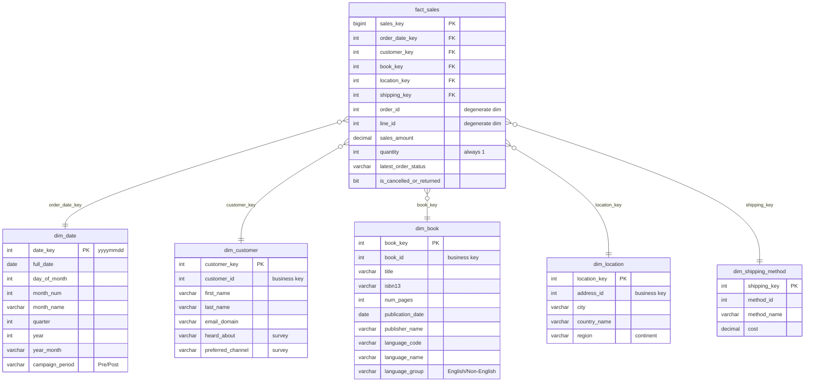

# Gravity Bookstore Data Warehouse — Project Plan

## 1. Goal

Build a data warehouse for the Gravity marketing department so they can see how a recent marketing campaign affected **international book sales**, especially sales of **non-English-language books**.

### Business questions

| # | Question | What it means in the data |
|---|----------|---------------------------|
| BQ1 | Where are the customers who buy our books, and how has their location changed over time? | Orders by **destination country / city** (`cust_order.dest_address_id → address → country`) sliced by **order date** (month / quarter / year). |
| BQ2 | Where do customers prefer to buy non-English books, and how has demand for them changed over time? | Order lines for books whose `book_language` is not English, sliced by **country** *and* by **preferred buying channel** from the survey (Online / Physical Store / Book Club / Other), over time and before vs after the campaign. |

"Where" in BQ2 is read two ways, and the report should say so: **geographically** (which countries) and by **channel** (how they prefer to buy, from the survey). The dashboard covers both.

---

## 2. Current state (checked 2026-10-27)

| Item | Status |
|------|--------|
| SQL Server | **Local** SQL Server 2025 Developer edition on this PC, default instance: server name `localhost`, **Windows authentication** (your login is sysadmin). Replaces the earlier Ubuntu server `192.168.1.128`. A SQL login `charles` (sysadmin) also exists and can be used if a SQL Server login is ever needed, but the SSIS packages use Windows authentication. |
| Operational DB `gravity_books` | **Built** 2026-10-27 with `sql/00_build_gravity_books.ps1`: 15 tables, 15 FKs. The script works around the missing `USE` in `01_sqlserver_create.sql` and adds `fk_ca_status`, which is in the data model but missing from the script. |
| `gravity_staging`, `gravity_dw` | **Built** 2026-10-27 from `sql/10`, `20`, `21`, `30` (13 staging tables; 10 DW tables; 3 procedures; campaign date in `etl.config`). |
| Survey file `bookstore survey.csv` | 1,999 rows, 3 columns: `Customer ID`, `How did you hear about Gravity`, `How do you prefer to buy books`. |
| Report template | `Computing - Template - Report.doc` (Intro → Body → Conclusions → References → Appendices). |
| Visual Studio | VS 2022 (Community + Professional) and VS 2026 Professional, all with the **SSIS extension installed**. OLE DB driver MSOLEDBSQL19 and SSMS 22 installed. |
| Power BI Desktop | Installed 2026-10-27 from the Microsoft Store (version 2.159.883.0, updates itself). Use it for the visualisation. |

### Data profile (useful for the design and the report)

Profiled 2026-10-27 after the local rebuild:

- Order dates: **2023-10-29 → 2026-10-27** (2023: 437, 2024: 2,455, 2025: 2,554, 2026: 2,104 orders).
- 7,550 orders and 15,400 order lines; **820 lines (5.3%) are non-English**.
- Orders ship to **109 countries / 974 cities**. Top countries: China 1,361, Indonesia 957, Russia 480, Brazil 319, Portugal 307.
- 487 orders were cancelled or returned at some point.

---

## 3. Assumptions and open questions

Confirm these with the tutor if possible. Either way, list them in the report as assumptions.

1. **Campaign date is not in the data.** Assume a campaign start date and keep it as a single parameter (row in `dw.etl_config`). Suggested value: **2025-10-01**, which gives 2 years before and 1 year after. Tag every date in `dim_date` as `Pre-campaign` / `Post-campaign`.
2. **"International":** the store's home country is unknown, so treat every country as a market and group countries into **continent / region** using a small reference CSV (`country_region.csv`) loaded via staging.
3. **English languages:** `eng`, `en-US`, `en-GB`, `en-CA` and `enm` (Middle English) count as English. `mul` (Multiple Languages) counts as **non-English**, with its own label so it can be filtered out.
4. **Customer location:** taken from the order's **destination address** at the time of the order. `customer_address` only holds current status (Active / Inactive) with no dates, so it can't show change over time.
5. **The survey is missing the third question** in the brief ("why do you prefer Gravity"). Note this as a gap. Customer 2000 has no survey response, so label it `No response`.
6. **Cancelled / returned orders** stay in the fact table with a flag, so the dashboard can include or exclude them. Gross vs net sales is a design choice to discuss.

---

## 4. Architecture

```
gravity_books (OLTP)          gravity_staging              gravity_dw (star schema)
  15 tables          ──SSIS──▶  stg_* tables      ──SSIS──▶  dim_* + fact_sales     ──▶  Power BI
bookstore survey.csv ──SSIS──▶  stg_survey        (cleanse,
country_region.csv   ──SSIS──▶  stg_country_region  conform, key lookups)
```

- There are **three databases** on the same server. Keeping them separate isolates the source, transient staging data and the warehouse, and the report can justify that.
- SSIS packages are built in **Visual Studio 2022 on Windows** and run from VS (or `dtexec`) against the **local** SQL Server 2025 (`localhost`, Windows authentication). Running from VS is fine for coursework. Because the server is Windows-based with SQL Agent running, deploying to the SSIS catalog (SSISDB) and scheduling with an Agent job is possible as an optional extra, or can be discussed in the report as the production approach.
- The project was first built against SQL Server 2022 on an Ubuntu server and moved to the local machine. Worth a line in the development section of the report.
- Power BI Desktop connects to `gravity_dw` only. The brief requires the visualisation to use the warehouse target tables.

---

## 5. Data warehouse design (star schema)

### Fact grain

**One row per order line** (`order_line`). Language is a property of the book, and only the line-level grain links an order to a book. An order-level fact would lose the language.

### Star schema



### Key design decisions (to explain in the report)

| Decision | Choice | Alternatives considered |
|----------|--------|-------------------------|
| Schema type | **Star schema**, as the brief recommends: simple for Power BI and fast to query. | Snowflake schema (separate language, publisher and country tables) normalises better but adds joins for little benefit at this size. |
| Language | **Denormalised into `dim_book`**, with a derived `language_group`. | Separate `dim_language` joined to the fact. Also valid, and worth mentioning. |
| Location | **Separate `dim_location` at address grain**, with a city → country → region hierarchy, linked from the fact through the order's destination address. | Putting location in `dim_customer` with SCD Type 2. Rejected because the source has no address history dates, while the order destination is already a point-in-time record. |
| Customer history | **SCD Type 1** (overwrite). Survey answers are attributes of the customer. | SCD Type 2 adds complexity without source history to drive it. |
| Survey | Joined into **`dim_customer`** on `customer_id`. | A separate `dim_survey` or a factless survey fact table. Overkill for 2 attributes. |
| Campaign | **`campaign_period` column in `dim_date`**, driven by a config date. | A separate `dim_campaign`. Better if there were several campaigns. |
| Surrogate keys | `INT IDENTITY` on every dimension, with the business key kept for lookups. An **unknown member (key = -1)** in every dimension handles failed lookups. | Using natural keys directly. Breaks if source keys change or are reused. |
| Order status | Latest status from `order_history` stored on the fact, plus an `is_cancelled_or_returned` flag. | A separate accumulating-snapshot fact for order lifecycle. Out of scope for these questions. |
| Out of scope | `author` / `book_author` aren't needed for either question. | Could add a `bridge_book_author` later. Mention this as a future extension. |

---

## 6. Staging design

`gravity_staging` uses the **`stg` schema**. Tables mirror their sources one-to-one with no constraints, so loads never fail on dirty data. Each table adds `load_datetime DATETIME2 DEFAULT SYSDATETIME()`. Columns read from flat files are wide `VARCHAR`s.

| Staging table | Source | Notes |
|---------------|--------|-------|
| `stg.book` | `book` | |
| `stg.book_language` | `book_language` | |
| `stg.publisher` | `publisher` | |
| `stg.customer` | `customer` | |
| `stg.address` | `address` | |
| `stg.country` | `country` | |
| `stg.cust_order` | `cust_order` | |
| `stg.order_line` | `order_line` | |
| `stg.order_history` | `order_history` | |
| `stg.order_status` | `order_status` | |
| `stg.shipping_method` | `shipping_method` | |
| `stg.survey` | `bookstore survey.csv` | All columns `VARCHAR(100)`, converted in the transform step. |
| `stg.country_region` | `country_region.csv` | Reference data you create (country → continent). |
| *(control tables)* | — | ETL audit log, config (campaign date) and data-quality results live in `gravity_dw` (`etl.audit`, `etl.config`, `dq.check_log`, `dq.fact_rejects`), so both packages log to one place. |

Draw the staging ER diagram for the report in SSMS (Database Diagrams) or draw.io. It's mostly unconnected tables, which is the point: say why staging has no FKs.

---

## 7. ETL design (SSIS)

### Package 1 — `Extract_To_Staging.dtsx`

**Control flow:**

```
[Execute SQL: log start in etl_audit]
        ↓
[Execute SQL: TRUNCATE all stg.* tables]
        ↓
[Sequence container: Extract OLTP]  ← 11 data flow tasks, run in parallel
        ↓
[Sequence container: Extract files] ← survey CSV, country_region CSV
        ↓
[Execute SQL: log row counts / end]
```

**Data flow (one per table):** `OLE DB Source (gravity_books.table)` → `Row Count (variable)` → `OLE DB Destination (stg.table)`

**Survey data flow:** `Flat File Source` → `Derived Column (TRIM, UPPER first letter)` → `Data Conversion` → `Row Count` → `OLE DB Destination (stg.survey)`

### Package 2 — `Transform_Load_DW.dtsx`

**Control flow:**

```
[Execute SQL: run data-quality checks → dq_log]
        ↓
[Sequence container: Load dimensions]   (in parallel)
   ├─ DFT dim_date        (or an Execute SQL proc that generates the date range)
   ├─ DFT dim_book        (book ⨝ language ⨝ publisher)
   ├─ DFT dim_customer    (customer ⟕ survey)
   ├─ DFT dim_location    (address ⨝ country ⟕ country_region)
   └─ DFT dim_shipping_method
        ↓  (on success only)
[DFT fact_sales]
        ↓
[Execute SQL: reconcile row counts staging vs DW → etl_audit]
```

**Dimension data flow example (`dim_book`):**
`OLE DB Source (SQL join in staging)` → `Derived Column` (pad ISBN to 13 characters, 0 pages → NULL, `language_group` from code) → `Lookup (dim_book on book_id)` → **no match**: `OLE DB Destination` (insert) / **match**: `OLE DB Command` or staging update table + `UPDATE` (SCD1). The built-in *Slowly Changing Dimension* wizard also works; mention it as an alternative.

**Fact data flow:**
`OLE DB Source (order_line ⨝ cust_order ⨝ latest order_history)` → `Derived Column (date_key = yyyymmdd)` → `Lookup dim_customer` → `Lookup dim_book` → `Lookup dim_location` → `Lookup dim_shipping_method` → (on any lookup failure: **redirect** → Derived Column key = -1, or write to `dq.fact_rejects`) → `Conditional Split` (price ≤ 0 → reject table) → `OLE DB Destination fact_sales`

### Package 3 — `Master.dtsx`

Uses **Execute Package Tasks**: Extract → Transform/Load, with precedence on success and an email or log step on failure. This is optional but makes for a good control-flow diagram.

**Load strategy:** **full reload** (truncate and load) for coursework, since the data volume is small. Discuss **incremental loads** (watermark on `order_date` / `order_id`, CDC) as the production alternative in the report.

---

## 8. Data cleansing plan

### Issues already found in the source

| # | Check | Result | Treatment in ETL |
|---|-------|--------|------------------|
| 1 | ISBN13 not 13 characters | **25 books**, e.g. `8987059752`: leading zeros lost | Left-pad with zeros to 13 (`RIGHT('0000000000000'+isbn13,13)`) |
| 2 | Books with 0 pages | **77 books** | Set `num_pages` to NULL (unknown), not 0 |
| 3 | Duplicate country name | **"Singapore" appears twice** (2 IDs) | Conform to one name in `dim_location` so the map doesn't split it |
| 3a | Historical / invalid countries | **21 historical** (Soviet Union, West Germany, Yugoslavia, Olympic teams…), **3 invalid** ("Unknown", "Individual Olympic Athletes", "Refugee Olympic Team") | Map to modern successor where clear (West Germany → Germany), otherwise flag with `country_status` (via `country_region.csv`) |
| 3b | Misspelt country | "Boliva" | Corrected to "Bolivia" via `clean_country_name` |
| 4 | Order lines with price ≤ 0 or NULL | **10 lines** | Send to the reject table, or keep with a flag. Discuss the choice. |
| 5 | Orders with no status history | **3 orders** (placed in the last 12 hours before the build) | `latest_order_status = 'Unknown'` |
| 6 | Cancelled / returned orders | **487 orders** | Keep them, set `is_cancelled_or_returned = 1`, and filter in Power BI |
| 7 | Books with no author | **1,069 books** | Not needed for the business questions. Log it as a finding. |
| 8 | Survey: missing customer | Customer 2000 has no row | `heard_about` / `preferred_channel = 'No response'` |
| 9 | Survey: missing question | The "why prefer Gravity" column isn't in the CSV | Report it as a requirements gap |
| 10 | Language codes | 5 English variants (`eng`, `en-US`, `en-GB`, `en-CA`, `enm`) | Map them to `language_group = 'English'` |

Checks that came back **clean**, also worth reporting: no NULL or badly formatted emails, no duplicate emails, no addresses missing a city or country, every order destination belongs to the customer, no status dates before the order date, no orders without lines.

### How to implement the checks (priority order)

1. **Referential integrity / orphan checks** (fact → dims): handled by SSIS Lookups with redirect rows and the unknown member.
2. **Completeness**: NULLs in key columns (ISBN, country, order date).
3. **Validity**: formats and ranges (ISBN length, price > 0, pages > 0, dates not in the future, email pattern).
4. **Uniqueness**: duplicates on business keys and names (country, customer email).
5. **Consistency**: conform codes (language, country names) and check row-count reconciliation between source, staging and DW.

Put the checks in a SQL script `dq_checks.sql` that writes to a `dq.check_log` table (check name, rows failing, run date), run from an **Execute SQL Task** at the start of Package 2. Improvements to discuss: automate thresholds that fail the package, schedule with SQL Agent, add a Power BI data-quality page, or use Data Quality Services / Great Expectations.

---

## 9. Visualisation (Power BI Desktop → `gravity_dw`)

Use **Import mode**, load the star schema, set relationships on the surrogate keys, and mark `dim_date` as the date table.

**Measures (DAX):** `Total Sales`, `Order Lines`, `Orders = DISTINCTCOUNT(order_id)`, `Customers = DISTINCTCOUNT(customer_key)`, `Non-English Sales` (filtered on `language_group`), `Non-English %`, `Sales Pre`, `Sales Post`, `Campaign Change %`.

| Page | Answers | Visuals |
|------|---------|---------|
| **1. Customer Locations** | BQ1 | Filled map / bubble map of orders by country · line chart of orders by region per quarter · table of top 10 countries with change from the previous year · year slicer / play axis to show location change over time |
| **2. Non-English Demand** | BQ2 | Map of non-English sales by country · stacked column chart of non-English sales by language per quarter · matrix of language × region · line chart of Non-English % over time with a **campaign start** reference line |
| **3. Channel & Campaign** | BQ2 + campaign | Bar chart of non-English buyers by **preferred channel** (survey) · `heard_about` × `preferred_channel` matrix · KPI cards Pre vs Post campaign (sales, customers, countries) · slicers: campaign_period, region, language_group, exclude cancelled |

Take screenshots of each page with filters applied. In the report, explain *how* each one answers its question.

---

## 10. Implementation checklist

### Phase 0 — Setup
- [x] Build `gravity_books` from the SQL files (rebuilt locally 2026-10-27 with `sql/00_build_gravity_books.ps1`)
- [x] Install the **SQL Server Integration Services Projects 2022** extension
- [x] Install SSMS if needed (SSMS 22 is installed)
- [x] Install Power BI Desktop on this PC
- [x] Create `reference/country_region.csv`: country → region for all 232 countries, plus a cleansing map (historical, invalid and misspelt names)
- [x] Campaign start date recorded in `gravity_dw.etl.config` (2025-10-01, assumed)

### Phase 1 — Databases and schemas (SQL scripts in `sql/`)
- [x] `10_create_staging.sql`: `gravity_staging` database + 13 `stg.*` tables
- [x] `20_create_dw.sql`: `gravity_dw` database + dimensions + `fact_sales` + FKs + unknown members (-1) + `etl`/`dq` tables
- [x] `21_etl_procedures.sql`: `etl.usp_load_dim_date` (2023-01-01 → 2026-12-31 with `campaign_period`) and `etl.usp_prepare_full_load`
- [x] `30_dq_checks.sql`: `dq.usp_run_checks`, 23 checks → `dq.check_log`

### Phase 2 — Extract (SSIS)
- [x] Generate `ssis/packages/Extract_To_Staging.dtsx` (`ssis/tools/build_extract_package.ps1`) with connection managers (OLTP, Staging, DW, survey CSV, region CSV)
- [x] Create the SSIS project `GravityETL` in Visual Studio and add the package (see the extract guide)
- [x] Run it and check that staging row counts equal the source (all 13 match, 2026-10-27)
- [x] 📸 Screenshot the control flow and one data flow (`diagrams/extract_*.png`)

### Phase 3 — Transform and load (SSIS)
- [x] Build `Transform_Load_DW.dtsx` (dimensions, then the fact), generated by `ssis/tools/build_transform_package.ps1`
- [x] Add it to the `GravityETL` project in Visual Studio
- [x] Run it and reconcile: fact rows = 15,400 order lines minus rejects (15,390 + 10 rejects, 2026-10-27)
- [x] 📸 Screenshot the control flow, one dimension data flow and the fact data flow (`diagrams/tl_*.png`)
- [ ] Optional: `Master.dtsx`

### Phase 4 — Data quality
- [x] Run `dq_checks.sql` before and `31_dw_checks.sql` after cleansing, and record the results table for the report (`docs/Data_Quality_Summary.md`)
- [x] Check that the cleansing rules worked (e.g. Singapore appears once, ISBNs are 13 characters), see the development log

### Phase 5 — Visualisation
- [x] Build the Power BI model, measures and the 3 pages (`powerbi/Gravity_Marketing.pbix`)
- [x] 📸 Screenshot each page and save the `.pbix` (`diagrams/pbi_*.png`)

### Phase 6 — Report (1,000–1,500 words, in the provided template)
- [ ] Write the report (structure below). Detailed outline: `report/Gravity_DW_Report_Outline.docx`; narrative draft (1,465 words): `report/Gravity_DW_Report_Draft.docx`
- [ ] Insert the figures: staging ER, DW ER, extract diagrams, transform/load diagrams, dashboard screenshots (all ready in `diagrams/`)
- [ ] Check the word count (Introduction to Conclusions only)

**Keep a development log while working** (errors, fixes, design changes). The report has to cover debugging and design changes, and it's much easier to write from notes. Likely entries: moving from the Ubuntu server to local SQL Server 2025 (and switching from `sa` to Windows authentication), the missing `USE` in `01_sqlserver_create.sql`, the missing `fk_ca_status`, the ISBN padding, data type mismatches in SSIS (VARCHAR vs NVARCHAR / DT_STR vs DT_WSTR), and lookup failures before the unknown members existed.

---

## 11. Report outline (about 1,400 words)

| Section | Words | Content | Figures |
|---------|-------|---------|---------|
| 1. Introduction | 100 | Context, business questions, scope, toolset | — |
| 2. Requirements interpretation | 150 | How BQ1 and BQ2 map to the data, the two meanings of "where", assumptions (§3) | — |
| 3. Warehouse design | 300 | Star schema, grain, dimensions, key decisions and alternatives (§5) | Staging ER, DW star ER |
| 4. ETL design | 250 | Staging approach, extract and transform/load packages, load strategy | Extract control/data flow, T&L control/data flow |
| 5. Development process | 200 | Build order, debugging, design changes (from the development log) | — |
| 6. Data cleansing | 200 | Checks, issues found (§8 table), treatments, automation ideas | DQ results table |
| 7. Visualisation | 200 | How each page answers BQ1 and BQ2, key insights | Dashboard screenshots |
| 8. Lessons learned & conclusions | 100 | What worked, what to improve (incremental loads, SCD2 with real history, automated DQ, scheduling, more survey questions) | — |

---

## 12. Deliverables folder layout

```
Module 4/
├── DW_Project_Plan.md
├── gravity_sqlserver/        (provided OLTP scripts)
├── bookstore survey.csv
├── reference/country_region.csv
├── sql/                      (staging, DW, dim_date, dq checks)
├── ssis/GravityETL/          (Visual Studio SSIS project)
├── powerbi/Gravity_Marketing.pbix
├── diagrams/                 (ER + ETL diagrams, screenshots)
└── report/Gravity_DW_Report.doc
```
