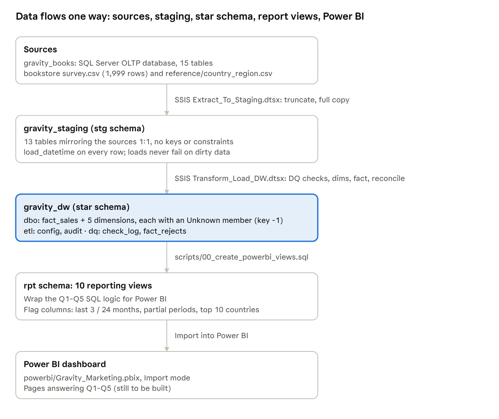
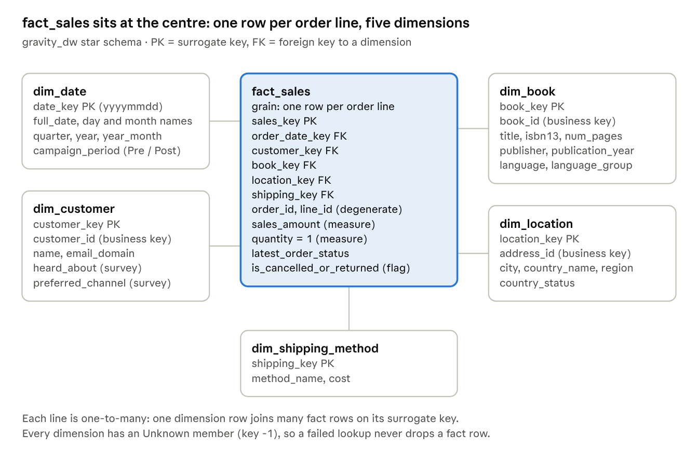
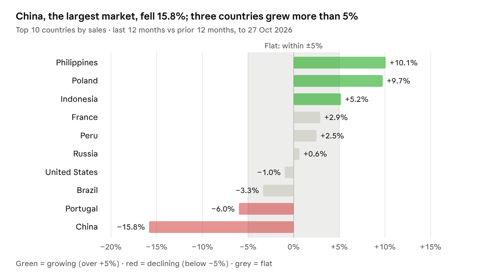

# Gravity Books DW – Solution Handover

16 November 2026

**Contents**

1. [Purpose and scope](#purpose-and-scope)
2. [Handover catalog](#handover-catalog)
3. [Solution architecture](#solution-architecture)
4. [Data warehouse model](#data-warehouse-model)
5. [Assumptions shared by all five questions](#assumptions-shared-by-all-five-questions)
6. [Q1 – Last three months vs expectations](#q1--last-three-months-vs-expectations)
7. [Q2 – Sales outside the expected range](#q2--sales-outside-the-expected-range-last-two-years)
8. [Q3 – Book price and page count vs units sold](#q3--book-price-and-page-count-vs-units-sold)
9. [Q4 – Factors that affect a book's total sales](#q4--factors-that-affect-a-books-total-sales)
10. [Q5 – Geographic sales and country trends](#q5--geographic-sales-and-country-trends)
11. [Power BI reporting views and dashboard mapping](#power-bi-reporting-views-and-dashboard-mapping)
12. [Data quality, limitations and file index](#data-quality-limitations-and-file-index)

## Purpose and scope

This handover explains the full Gravity Books solution — warehouse model, ETL, assumptions and how each of the five business questions is answered — so the report and video can be written without re-reading the code.

The final project reuses our mid-module (MMA) data warehouse, `gravity_dw`, and builds a Power BI dashboard on it. The brief's five questions are:

1. What are our current sales for the last three months and how does this match expectations?
2. Have sales been outside of the expected range any time in the past two years?
3. How do the cost of the book and the number of pages affect the number of books sold?
4. What are the factors that affect the total sales of a book?
5. What geographical areas have the most sales and what are the trends for different countries?

Everything referenced here is in this repository; file paths below are relative to its root.

## Handover catalog

The files handed over are listed in build order: source data first, then the warehouse, the ETL, the analysis and the dashboard.

| Area | File(s) | What it is | Use it for |
|---|---|---|---|
| Source data | `gravity_sqlserver/01_sqlserver_create.sql` | Creates the 15 tables of the operational `gravity_books` database | Rebuilding the source system |
| Source data | `gravity_sqlserver/02–13_sqlserver_populate_*.sql` (12 files) | Populate authors, publishers, lookups, books, book authors, countries, addresses, customers, orders, order lines and order history | Rebuilding the source system (scripts 10–13 generate random orders) |
| Source data | `bookstore survey.csv` | Customer survey: 1,999 rows (heard about us, preferred channel) | Survey attributes on `dim_customer` |
| Source data | `reference/country_region.csv` | Country → region map plus clean names for duplicate, misspelt and historical countries | Regions and country cleansing in `dim_location` |
| Source data | `data_model.png` | The provided Gravity source data model | Explaining where the data comes from |
| Warehouse build | `sql/00_build_gravity_books.ps1` | Runs the 13 source scripts in order and fixes the missing `USE` and FK | One-step source rebuild |
| Warehouse build | `sql/10_create_staging.sql` | Creates `gravity_staging`: 13 `stg` tables, no constraints | Staging layer |
| Warehouse build | `sql/20_create_dw.sql` | Creates `gravity_dw`: `fact_sales`, 5 dimensions, FKs, Unknown members, `etl` and `dq` tables | The star schema (see Data warehouse model) |
| Warehouse build | `sql/21_etl_procedures.sql` | `etl.usp_prepare_full_load` and `etl.usp_load_dim_date` | Called by the SSIS transform package |
| Data quality | `sql/30_dq_checks.sql` | `dq.usp_run_checks`: 23 checks on staging | Before-cleansing results in `dq.check_log` |
| Data quality | `sql/31_dw_checks.sql` | `dq.usp_run_dw_checks`: 15 checks on the warehouse | After-cleansing results in `dq.check_log` |
| ETL | `ssis/GravityETL/` (`.sln`, `.dtproj`, `.database`, `Project.params`) | Visual Studio SSIS project | Opening and running the packages in Visual Studio |
| ETL | `ssis/GravityETL/Extract_To_Staging.dtsx` | Package 1: copies source tables and CSVs into staging, logs row counts | Extract step |
| ETL | `ssis/GravityETL/Transform_Load_DW.dtsx` | Package 2: DQ checks, dimensions, fact via lookups, reconciliation | Transform and load step |
| ETL | `ssis/packages/*.dtsx` (2 files) | Generated versions of the two packages, before they were added to the project | Reference only; the project copies are current |
| ETL | `ssis/tools/*` (5 files) | C# and PowerShell generators that build the `.dtsx` packages | Regenerating the packages |
| Analysis | `scripts/Q1–Q5_*.sql` (5 files) | One SQL script per business question | The answers and figures in sections Q1–Q5 |
| Analysis | `scripts/Q1–Q5_*.md` (5 files) | Step-by-step explanation of each script, with results | Understanding and presenting each answer |
| Analysis | `scripts/00_create_powerbi_views.sql` | Creates the 10 `rpt` reporting views | Data source for the dashboard pages |
| Dashboard | `powerbi/Gravity_Marketing.pbix` | Power BI file: model, measures and 3 mid-module pages | Starting point for the Q1–Q5 pages |
| Dashboard | `powerbi/Gravity_Marketing_before_pages.pbix`, `powerbi/powerbi.pbix` | Earlier copies saved before the pages were added | Backup only |
| Dashboard | `powerbi/tools/*.ps1` (4 files) | Scripts that connect to the model, add and check measures, and build pages | Rebuilding the model and pages |
| Diagrams | `diagrams/er_staging.*`, `diagrams/er_warehouse.*` (PNG + SVG) | ER diagrams of staging and the star schema | Report and video |
| Diagrams | `diagrams/extract_*.png` (4), `diagrams/tl_*.png` (5) | Screenshots of the SSIS control and data flows | Explaining the ETL |
| Diagrams | `diagrams/pbi_*.png` (6) | Screenshots of the Power BI model and the 3 mid-module pages | Reference for the dashboard |
| Diagrams | `diagrams/handover/*.png` (3) | Architecture, star schema and Q5 country-trend images | Figures in these handover notes |
| Diagrams | `diagrams/shot9.png` | Unlabelled screenshot | Check before using |
| Diagrams | `diagrams/tools/build_er_diagrams.py` | Script that draws the two ER diagrams | Redrawing them after a model change |
| Documentation | `README.md` | Repository overview and rebuild steps | First stop for anyone opening the repo |
| Documentation | `DW_Project_Plan.md` | Original plan: design decisions, staging, ETL, cleansing plan | Rationale behind the design |
| Documentation | `docs/Data_Quality_Summary.md` | Checks, issues found, treatments, before/after counts | Data quality discussion |
| Documentation | `docs/PowerBI_Guide.md` | Steps for the model, measures, pages and checks | Building the dashboard |
| Documentation | `handoverNotes.md` | These notes, as Markdown (renders on GitHub) | Overview of the whole solution |
| Documentation | `handoverNotes.html` | The same notes as one self-contained web page | Reading offline in a browser |

## Solution architecture

The solution is three SQL Server databases on one server, loaded by two SSIS packages and read by Power BI through a reporting layer.

*Solution architecture · from DW_Project_Plan.md and the sql/, ssis/, scripts/ folders*

- **Why three databases:** keeping the source, transient staging data and the warehouse apart isolates each step; staging has no constraints so the extract never fails, and cleansing happens in one place.
- **Extract (`Extract_To_Staging.dtsx`):** logs start in `etl.audit`, truncates staging, copies 11 OLTP tables and 2 CSV files in parallel, logs row counts.
- **Transform & load (`Transform_Load_DW.dtsx`):** runs `dq.usp_run_checks`, clears the star (`etl.usp_prepare_full_load`), builds `dim_date` (`etl.usp_load_dim_date`), loads the four other dimensions, then the fact through surrogate-key lookups, then reconciles row counts and fails on any mismatch.
- **Load strategy:** full reload each run, appropriate for this data volume; incremental loads (watermark on order date, CDC) are the production alternative to mention.

## Data warehouse model

`gravity_dw` is a **star schema**: one fact table, `fact_sales`, at the grain of **one order line** (one book sold), surrounded by five dimensions.

*gravity_dw star schema · from sql/20_create_dw.sql*

**The fact table.** 15,390 rows. Two measures: `sales_amount` (the line's price) and `quantity` (always 1, so units = row count). `order_id` and `line_id` are degenerate dimensions kept for counting orders. `latest_order_status` and `is_cancelled_or_returned` come from `order_history` and let the dashboard show gross or net sales. Line grain was chosen because only the order line links an order to a book, and book attributes (language, price, pages) drive Q3 and Q4.

**The dimensions and the questions they serve**

| Dimension | Describes | Built from | Used by |
|---|---|---|---|
| `dim_date` | Each calendar day 2023–2026, tagged Pre/Post campaign | Generated by `etl.usp_load_dim_date` | Q1, Q2, Q4 (campaign), Q5 (trend) |
| `dim_customer` | Each customer, plus their survey answers | `customer` left-joined to the survey CSV | Q4 (heard-about, channel) |
| `dim_book` | Each book with publisher and language denormalised in | `book` ⨝ `book_language` ⨝ `publisher` | Q3, Q4 |
| `dim_location` | Each delivery address, city → country → region | `address` ⨝ `country` ⟕ `country_region.csv` | Q5 |
| `dim_shipping_method` | Each shipping method and its cost | `shipping_method` | Q4 |

**Relationships.** Every dimension joins `fact_sales` one-to-many on an `INT IDENTITY` surrogate key, enforced by foreign keys (`fk_fact_date`, `fk_fact_customer`, `fk_fact_book`, `fk_fact_location`, `fk_fact_shipping`). Business keys (`customer_id`, `book_id`, `address_id`, `method_id`) are kept unique on each dimension for the ETL lookups.

**Key design decisions**

| Decision | Choice | Alternative considered |
|---|---|---|
| Schema type | Star: simple for Power BI, fast to query | Snowflake (separate language, publisher, country tables): more joins for little gain |
| Language | Denormalised into `dim_book` with derived `language_group` | Separate `dim_language` |
| Location | Own dimension at address grain, from the order's destination address | In `dim_customer` with SCD Type 2: no address history dates exist |
| History | SCD Type 1 (overwrite) | SCD Type 2: no source history to drive it |
| Survey | Attributes on `dim_customer` | Separate survey dimension: overkill for two fields |
| Campaign | `campaign_period` column on `dim_date`, driven by `etl.config` | `dim_campaign`: better if there were several campaigns |
| Failed lookups | Unknown member (key −1) in every dimension | Dropping rows: loses sales silently |
| Authors | Out of scope | `bridge_book_author` as a future extension |

## Assumptions shared by all five questions

These rules apply to every query and every reporting view, and should be stated in the report as assumptions.

| # | Assumption | Why | Where it lives |
|---|---|---|---|
| A1 | "Today" = the latest order date in the warehouse, **27 Oct 2026**, not `GETDATE()` | The clock would move the "last three months" every run and could land on empty months | Every Q script and `rpt` view (`bounds` CTE) |
| A2 | Partial months are scaled to a full month: sales × days in month ÷ days with data | Oct 2026 has 27 of 31 days; Oct 2023 has 3 days (data starts 29 Oct 2023) | `scaled` CTE in Q1, Q2 |
| A3 | The first partial month (Oct 2023) is left out of the expected-range baseline | 3 days would drag the average down and widen the band | Q2, `rpt.v_monthly_sales` |
| A4 | "Expected" = trailing 12-month average (and same month last year); expected range = 12-month mean ± 2 standard deviations | The source has no budget or target | Q1, Q2 |
| A5 | "Cost of the book" = its average selling price | `book` has no list price; price is on each order line and varies per sale | Q3, `rpt.v_book_sales` |
| A6 | Sales are **gross** (cancelled/returned lines included) unless stated; net is available via `is_cancelled_or_returned` | 487 orders were cancelled or returned at some point; keeping them lets the dashboard switch | `fact_sales` flag |
| A7 | Quantity is always 1, so one fact row = one book sold (units = row count) | Source `order_line` has no quantity column | `fact_sales.quantity` |
| A8 | Location = the order's **delivery address** at order time, grouped into continent regions | `customer_address` has no history dates | `dim_location`, `reference/country_region.csv` |
| A9 | Campaign start assumed **1 Oct 2025** (24 months before, 13 after) | No campaign date in the source | `etl.config`, `dim_date.campaign_period` |
| A10 | English = `eng`, `en-US`, `en-GB`, `en-CA`, `enm`; `mul` counts as non-English | Conform five code variants into one group | `dim_book.language_group` |
| A11 | Factor comparisons use **average sales per book**, and drop groups under 30 books | Totals favour big groups; tiny groups give luck-driven averages | Q4 |

One caveat runs through every result: orders, order lines, order history and addresses in `gravity_books` were **randomly generated** by the provided scripts. Flat, patternless findings (Q2, Q3, Q4) are therefore real properties of this data, and "no relationship" is an honest answer.

## Q1 – Last three months vs expectations

**Answer:** sales for 1 Aug – 27 Oct 2026 were **12,567.27** (1,247 units), **2.3% above** the same dates in 2025, and every month sits within about ±9% of expected. Sales are in line with expectations.

Files: `scripts/Q1_current_sales_vs_expected.sql` · views `rpt.v_monthly_sales`, `rpt.v_last3_vs_prior_year`

**Method**

1. `bounds` CTE finds the first and last order dates (29 Oct 2023 → 27 Oct 2026) by joining `fact_sales` to `dim_date`.
2. `monthly` CTE groups by year and month: gross sales, net sales (excluding cancelled/returned), units (`COUNT(*)`), orders (`COUNT(DISTINCT order_id)`).
3. `scaled` CTE computes the partial-month factor: Oct 2026 = 31 ÷ 27 = 1.148, so 4,072.11 becomes 4,675.39.
4. `calc` CTE uses window functions: `LAG(sales, 12)` for the same month last year, and `AVG(...) OVER (ROWS BETWEEN 12 PRECEDING AND 1 PRECEDING)` for the trailing 12-month expectation (the current month is excluded from its own baseline).
5. Final select returns the latest 3 months with % change vs last year and vs expected (`NULLIF` guards against divide-by-zero).
6. Query Q1b totals 1 Aug – 27 Oct for 2026 and 2025, so both periods have identical dates and need no scaling.

**Results**

| Month | Units | Sales | Full-month sales | Same month last year | vs last year | Expected (12-m avg) | vs expected |
|---|---|---|---|---|---|---|---|
| 2026-10 | 395 | 4,072.11 | 4,675.39 | 3,890.40 | +20.2% | 4,296.88 | +8.8% |
| 2026-09 | 396 | 3,978.51 | 3,978.51 | 3,966.26 | +0.3% | 4,295.86 | −7.4% |
| 2026-08 | 456 | 4,516.65 | 4,516.65 | 4,801.24 | −5.9% | 4,319.57 | +4.6% |

Treat October's +20.2% with care: October 2025 was a weak month and October 2026 is scaled up from 27 days.

**Dashboard use:** KPI cards for the 3-month total and % vs last year (from `rpt.v_last3_vs_prior_year`), plus a clustered column of actual vs expected per month from `rpt.v_monthly_sales`.

## Q2 – Sales outside the expected range (last two years)

**Answer:** no. All 24 months from Nov 2024 to Oct 2026 fall **within** the expected range; sales are stable at about 4,300 a month.

Files: `scripts/Q2_sales_outside_expected_range.sql` · view `rpt.v_monthly_sales` (filter `is_last_24_months = 1`)

**Method – a control chart**

- Expected = mean of the previous 12 months; upper/lower limit = mean ± 2 standard deviations. About 95% of normal months fall inside ±2 SD, so a month outside is roughly a 1-in-20 signal.
- z-score = (month − mean) ÷ SD; |z| > 2 means outside the range.
- Window functions `AVG`, `STDEV` and `COUNT` over `ROWS BETWEEN 12 PRECEDING AND 1 PRECEDING` give each month its own rolling band without collapsing rows.
- Oct 2023 (3 days) is removed from the baseline; Oct 2026 is scaled to a full month.
- Only months with a full 12-month baseline are kept, so every band is computed the same way. A `CASE` labels each month `Above range` / `Below range` / `Within range`.

**Results (selected months)**

| Month | Sales | Expected | Lower | Upper | Status | z |
|---|---|---|---|---|---|---|
| 2026-10 | 4,675.39 | 4,296.88 | 3,593.30 | 5,000.46 | Within range | 1.08 |
| 2026-07 | 4,814.26 | 4,282.55 | 3,592.21 | 4,972.89 | Within range | 1.54 |
| 2026-06 | 3,857.80 | 4,318.08 | 3,681.33 | 4,954.83 | Within range | −1.45 |
| 2025-05 | 5,160.95 | 4,338.54 | 3,475.41 | 5,201.68 | Within range | 1.91 |
| 2024-11 | 4,246.61 | 4,199.00 | 3,112.86 | 5,285.14 | Within range | 0.09 |

The closest call was **May 2025** (z = 1.91), about 40 below the upper limit; the weakest was **June 2026** (z = −1.45). The full 24 rows are in the script output.

**Dashboard use:** a line of `full_month_sales` with `lower_limit` and `upper_limit` as a shaded band, points coloured by `range_status` so any future breach stands out.

## Q3 – Book price and page count vs units sold

**Answer:** neither matters. Units vs price r = **0.001**, units vs pages r = **0.002**; every price band sells about 3,800 units and every page band about 1.4 copies per book.

Files: `scripts/Q3_price_and_pages_vs_units_sold.sql` · views `rpt.v_sales_by_price_band`, `rpt.v_book_sales`, `rpt.v_price_pages_correlation`

**Method**

- **3a Price bands:** a `CASE` buckets each sale (Under 5, 5–9.99, 10–14.99, 15+); numeric prefixes keep the bands sorted.
- **3b Page bands:** `dim_book LEFT JOIN fact_sales`, so unsold books count as 0; compares **average units per book**, since band sizes differ (5,102 books at 200–399 pages vs 438 at 800+).
- **3c One row per book:** pages, average price, units, sales – the data for a scatter plot.
- **3d Pearson correlation:** SQL Server has no `CORREL`, so r = (AVG(xy) − AVG(x)·AVG(y)) ÷ (STDEVP(x)·STDEVP(y)), over 9,470 books that sold.

**Units by price band (3a)**

| Price band | Units sold | Sales | Avg price |
|---|---|---|---|
| Under 5 | 3,770 | 9,345.81 | 2.48 |
| 5 – 9.99 | 3,835 | 28,719.18 | 7.49 |
| 10 – 14.99 | 3,898 | 48,817.22 | 12.52 |
| 15 and over | 3,887 | 68,084.13 | 17.52 |

**Units by page band (3b)**

| Page band | Books | Units sold | Avg units per book | % never sold |
|---|---|---|---|---|
| Under 200 | 2,824 | 3,875 | 1.372 | 14.6% |
| 200 – 399 | 5,102 | 7,140 | 1.399 | 13.6% |
| 400 – 599 | 2,049 | 2,787 | 1.360 | 15.5% |
| 600 – 799 | 637 | 890 | 1.397 | 13.3% |
| 800 and over | 438 | 596 | 1.361 | 16.7% |

Price and pages are also unrelated to each other (r = −0.004). Expensive bands earn more **revenue** only because each sale is worth more, not because they sell more copies.

**Dashboard use:** a column chart of units by price band, a scatter of price vs pages sized by units (from `rpt.v_book_sales`), and card(s) showing the r values.

## Q4 – Factors that affect a book's total sales

**Answer:** no book attribute strongly drives sales – all average about **14 per book**. A group's total is driven mainly by **how many titles it has**. The campaign period shows a small **+3.4%** lift in average monthly sales.

Files: `scripts/Q4_factors_affecting_book_sales.sql` · views `rpt.v_factor_spread`, `rpt.v_book_sales`, `rpt.v_customer_factors`, `rpt.v_campaign_effect`

**Method**

- Factors tested: book attributes from `dim_book` (language, language group, publisher, publication decade, page band) and sale attributes from `dim_customer`, `dim_shipping_method` and `dim_date` (heard-about, preferred channel, shipping method, campaign period).
- **Per-book averages, not totals:** English has 8,911 books and Japanese 46, so totals mislead.
- **4a Factor spread:** `book_sales` CTE (one row per book, unsold = 0 via `LEFT JOIN` + `ISNULL`) → `levels` CTE unpivots five factors with `UNION ALL` → `per_level` averages per level with `HAVING COUNT(*) >= 30` → spread = best − worst level.
- **4b–4c:** detail by language and top 15 publishers. **4d:** customer and delivery factors. **4e:** pre vs post campaign, compared as **average monthly** sales because the periods are 24 and 13 months.

**Factor spread (4a)**

| Factor | Levels compared | Lowest avg / book | Highest avg / book | Spread |
|---|---|---|---|---|
| Publisher | 77 | 10.55 | 18.49 | 7.95 |
| Language | 7 | 13.28 | 16.12 | 2.85 |
| Publication decade | 6 | 13.61 | 14.50 | 0.90 |
| Language group | 2 | 13.89 | 14.64 | 0.76 |
| Page band | 5 | 13.59 | 14.15 | 0.56 |

Publisher's larger spread is mostly noise: with 77 groups of 30–50 books, some land high or low by chance.

**Customer, delivery and campaign factors (4d–4e)**

| Factor | Finding |
|---|---|
| Heard about us | Friend recommendation brings most customers (547); every source spends about 88 per customer |
| Preferred channel | Online is largest (1,075 customers); spend per customer is 88–91 in every channel |
| Shipping method | Express carries most sales (8,848 books, 57% of sales) |
| Campaign period | Pre: 4,138.82 avg/month (24 months); Post: 4,279.59 (13 months) = +3.4%, within normal variation (Q2) |

English leads total sales (123,425) but is ordinary per book (13.85); Portuguese's 23.18 per book rests on only 10 books.

**Dashboard use:** a bar chart of spread by factor (`rpt.v_factor_spread`), bars of customers by heard-about and channel, and pre/post campaign KPI cards.

## Q5 – Geographic sales and country trends

**Answer:** Asia (44.7%) and Europe (29.9%) make up three-quarters of sales; China (17.7%) and Indonesia (12.5%) alone are nearly a third. China, the largest market, is **declining (−15.8%)**, while the Philippines, Poland and Indonesia are growing.

Files: `scripts/Q5_geographic_sales_and_country_trends.sql` · views `rpt.v_country_sales`, `rpt.v_country_quarterly`

**Method**

- "Where" = the delivery address in `dim_location` (city → country → region), via `fact_sales.location_key`.
- **5a Region share:** `SUM(sales) / SUM(SUM(sales)) OVER ()` – an empty window gives the grand total in the same query.
- **5b Country rank:** `RANK() OVER (ORDER BY SUM(sales) DESC)`, plus distinct customers per country.
- **5c Trend:** rolling 12-month periods ending 27 Oct 2026 (calendar years fail: 2023 has 3 days, 2026 is incomplete). Conditional aggregation (`SUM(CASE WHEN date in period THEN sales ELSE 0 END)`) gives both periods in one pass; ±5% counts as Flat.
- **5d Quarterly series** for the top 10 countries; first (2023-Q4) and last (2026-Q4) quarters are partial and flagged `is_partial_quarter = 1`.

**Sales by region (5a)**

| Region | Countries | Units | Sales | % of total |
|---|---|---|---|---|
| Asia | 29 | 6,944 | 69,259.81 | 44.7% |
| Europe | 33 | 4,584 | 46,407.39 | 29.9% |
| South America | 7 | 1,499 | 15,481.43 | 10.0% |
| North America | 10 | 1,245 | 12,275.00 | 7.9% |
| Africa | 24 | 959 | 9,846.72 | 6.4% |
| Oceania | 6 | 159 | 1,695.99 | 1.1% |

**Country trends (5c)**

*Q5 script output (query 5c) · top 10 countries by total sales*

China's quarterly sales peaked in 2024-Q4 (2,887) and have held at about 2,000–2,200 since; as the largest market it is the trend most worth watching. Russia, Brazil, the USA, France and Peru are flat.

**Dashboard use:** a filled map coloured by sales or `pct_change_12m`, a top-10 bar chart, and a quarterly line chart filtered to `is_top_10_country = 1` and `is_partial_quarter = 0`.

## Power BI reporting views and dashboard mapping

The dashboard reads ten views in a `rpt` schema, created by `scripts/00_create_powerbi_views.sql`. Each view wraps the logic of a Q script; views cannot use `TOP` or `ORDER BY`, so they return full data plus flag columns to filter on in Power BI.

| View | Questions | Grain | Key columns / filters | Suggested visual |
|---|---|---|---|---|
| `rpt.v_monthly_sales` | Q1, Q2 | One row per month | `full_month_sales`, `expected_sales`, `lower_limit`, `upper_limit`, `z_score`, `range_status`, `is_last_3_months`, `is_last_24_months` | Line with shaded expected band; actual vs expected columns |
| `rpt.v_last3_vs_prior_year` | Q1 | 2 rows (two periods) | `period`, `units`, `gross_sales`, `net_sales` | KPI cards with % change |
| `rpt.v_sales_by_price_band` | Q3 | One row per price band | `band_order`, `price_band`, `units_sold`, `sales`, `avg_price` | Column chart (sort by `band_order`) |
| `rpt.v_book_sales` | Q3, Q4 | One row per book, incl. unsold | `avg_price`, `num_pages`, `units_sold`, `page_band`, `publication_decade`, `has_sold` | Scatter (price × pages, size = units) |
| `rpt.v_price_pages_correlation` | Q3 | 1 row | `r_units_vs_price`, `r_units_vs_pages`, `r_price_vs_pages` | Cards |
| `rpt.v_factor_spread` | Q4 | One row per factor | `levels_compared`, `lowest/highest_avg_sales_per_book`, `spread` | Bar chart of spread |
| `rpt.v_customer_factors` | Q4 | One row per factor level | `factor`, `level_name`, `customers`, `sales_per_customer` | Bars, sliced by `factor` |
| `rpt.v_campaign_effect` | Q4 | 2 rows (pre/post) | `months`, `avg_monthly_sales` | KPI cards |
| `rpt.v_country_sales` | Q5 | One row per country | `sales_rank`, `pct_of_total`, `pct_change_12m`, `trend` | Filled map; top-10 bars |
| `rpt.v_country_quarterly` | Q5 | Country × quarter | `is_top_10_country`, `is_partial_quarter` | Line chart, one line per country |

The star schema itself (dims + `fact_sales`) can also be loaded in Import mode with relationships on the surrogate keys and `dim_date` marked as the date table, for slicers (region, language group, campaign period, exclude cancelled).

**Status:** `powerbi/Gravity_Marketing.pbix` (saved 28 Oct) holds the three mid-module pages – Customer Locations, Non-English Demand, Channel & Campaign. The `rpt` views were written on 4 Nov, so dashboard pages for Q1–Q5 still need to be built on top of them.

## Data quality, limitations and file index

Every one of the 15,400 source order lines is accounted for: 15,390 loaded to `fact_sales` and 10 zero-price lines rejected to `dq.fact_rejects`. The load fails if staging and warehouse counts differ.

**Main cleansing rules** (full detail: `docs/Data_Quality_Summary.md`)

| Issue | Found | Treatment |
|---|---|---|
| ISBN13 not 13 characters (leading zeros lost) | 25 books | Left-padded to 13 |
| Books with 0 pages | 77 books | `num_pages` = NULL (unknown) |
| Order lines with price 0 | 10 lines | Rejected to `dq.fact_rejects` with a reason |
| Orders with no status history | 3 orders | `latest_order_status = 'Unknown'` |
| Customer with no survey response | 1 (customer 2000) | `heard_about` / `preferred_channel` = `No response` |
| Duplicate / misspelt / historical countries | Singapore ×2, "Boliva", 24 historical | Conformed via `reference/country_region.csv` |
| English code variants | 5 codes | Grouped as `language_group = 'English'` |
| Cancelled or returned orders | 487 orders | Kept and flagged `is_cancelled_or_returned` |

Checks run in two procedures: `dq.usp_run_checks` (23 checks on staging, `sql/30_dq_checks.sql`) and `dq.usp_run_dw_checks` (15 checks on the warehouse, `sql/31_dw_checks.sql`), both logged to `dq.check_log`.

**Limitations to mention in the report**

- Orders, lines, history and addresses are randomly generated, so Q3 and Q4 show no relationships.
- No sales target exists; "expected" is derived from history (A4).
- No list price exists; "cost" is average selling price (A5).
- Campaign date is assumed (A9); the survey lacks the brief's "why prefer Gravity" question.
- Do not rebuild `gravity_books`: the random scripts would change every number in this document.

**File index**

| Folder / file | Contents |
|---|---|
| `gravity_sqlserver/` | Provided scripts 01–13 that create and populate the source `gravity_books` |
| `sql/` | `00_build_gravity_books.ps1`, `10_create_staging.sql`, `20_create_dw.sql`, `21_etl_procedures.sql`, `30_dq_checks.sql`, `31_dw_checks.sql` |
| `ssis/` | `GravityETL` project: `Extract_To_Staging.dtsx`, `Transform_Load_DW.dtsx`, plus generator tools |
| `scripts/` | `00_create_powerbi_views.sql` and the Q1–Q5 `.sql` + `.md` explanations |
| `powerbi/` | `Gravity_Marketing.pbix` and measure/page scripts |
| `diagrams/` | ER diagrams (staging, warehouse), SSIS flow and Power BI screenshots |
| `docs/` | Data Quality Summary, Power BI Guide |
| `reference/`, `bookstore survey.csv` | Country→region map and survey source |
